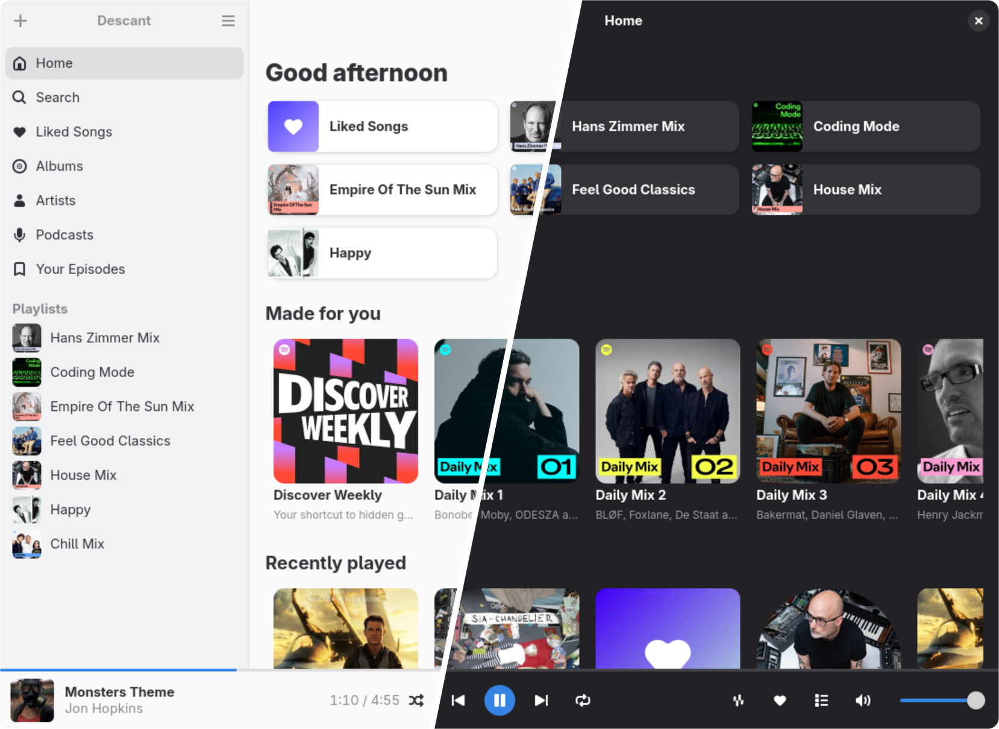
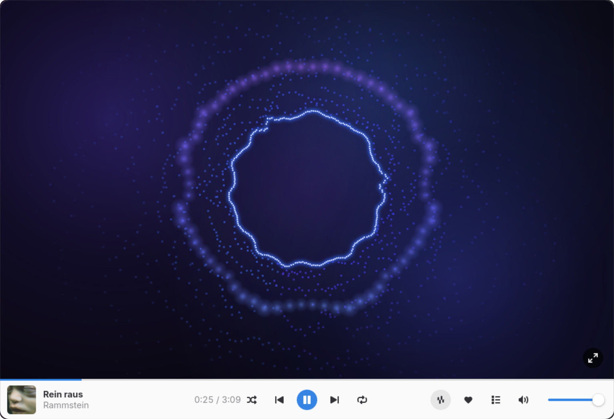

<p align="center">
  
</p>

<h1 align="center">Descant</h1>

<p align="center">A small, fast, native GNOME client for Spotify.</p>

Descant plays your music and gets out of the way. It is written in Rust with
GTK 4 and libadwaita, plays through [librespot](https://github.com/librespot-org/librespot),
and is built to be light on your computer and to keep playing when other
clients go quiet.

<p align="center">
  
</p>

## What Descant stands for

**Frugal.** Every feature has to earn its memory. At rest, with Home open,
Descant uses about 32 MB of memory of its own and 17 threads, and no CPU at
all: it wakes up when you do something. Track lists only build the rows you
can see, episodes come twenty at a time, covers are kept at exactly the
pixels they fill on your screen, and every cache has a cap. Podcasts cost
nothing until you open one.

**Sound that keeps playing.** Spotify rations the keys that unlock each
track. Clients that ignore this start skipping tracks or playing silence.
Descant paces itself, waits out a throttle instead of failing, reconnects on
its own after sleep or a network change, and picks up where you left off the
next time you open it.

**Native.** Descant is a GNOME app, not a web page in a window. It follows the
GNOME Human Interface Guidelines, adapts to narrow windows, follows your light
or dark style and accent colour, keeps its settings in GSettings, works with
media keys and the shell's media controls (MPRIS), and ships as a Flatpak.

**Focused.** Playlists, podcasts, search, discovery, your library and
playback, done well. No skins, no friend feed, no news, no audiobooks. A
smaller app has fewer places for bugs to hide. The one indulgence, a
visualizer, costs nothing until you switch it on.

**Private.** Descant has no servers, no telemetry and no developer key of its
own. It talks to Spotify with your own session and nothing else. Your sign-in
lives in the system keyring, and audio is streamed, never stored.

## Features

- **Sign in with your phone:** scan a QR code, confirm in the Spotify app.
- **Home:** quick tiles, Continue listening and New episodes, Made for You,
  Recently Played, your top artists and songs.
- **Search** for songs, artists, albums, playlists, podcasts and episodes, or
  paste a Spotify link.
- **Podcasts:** follow shows, save episodes to Your Episodes, and go on where
  you left off; jump back 15 seconds or ahead 30.
- **Your library:** Liked Songs (newest first), saved albums, followed
  artists and your playlists. Like tracks, create playlists, add and remove
  tracks.
- **Playback:** queue, shuffle, repeat and volume. Descant remembers the track
  and the moment you stopped at.
- **Spotify Connect:** Descant shows up as a device you can play to from your
  phone, songs and episodes alike.
- **Media controls:** play, skip, seek and set the volume from the media keys,
  GNOME's media controls, GSConnect or `playerctl` (MPRIS).
- **Ten-band equalizer** with presets, for playback on this computer.
- **Visualizer:** the button beside the heart turns the music to light above
  the bar, in step with what you hear; a click on it plays or pauses, and the
  corner button, <kbd>F11</kbd> or a double click take it full screen,
  <kbd>Esc</kbd> brings it back. When a
  song starts, its cover and title show in the corner for a moment.
  In Preferences, under Visualizer:
  - four presets: **Tunnel** (the waveform as a ring, its echoes zooming
    out), **Nebula** (clouds of colour, the waveform rising like smoke),
    **Spectrum** (glowing bars over a mirroring horizon) and **Starfield**
    (stars flying faster as the music gets louder);
  - colours from your **accent colour** (on by default; it follows when you
    pick another in GNOME's Appearance settings), or the rainbow;
  - optionally **another preset with every song**.

  It costs nothing while it is off or out of sight, stops drawing when the
  music pauses, and draws half as often (30 instead of 60 frames a second)
  when GNOME's **power saver** mode is on.
- **Keep playing in the background** when the window is closed, if you want.
- **Keyboard shortcuts:** <kbd>Ctrl</kbd>+<kbd>?</kbd> lists them.

<p align="center">
  
</p>

You need a **Spotify Premium** account; librespot cannot play on a free one.

**Not every account can still play.** Descant plays through librespot, which
Spotify treats as an older kind of Connect device (the "eSDK v1" used by
speakers and streamers). Spotify is phasing those out: in its words, only
accounts that have played on such a device within the last year can go on
using them, and new accounts can no longer be enabled. On an account that
can't, Descant says so plainly; browsing, search and your library still work,
and the music plays in Spotify's own apps or at
[open.spotify.com](https://open.spotify.com). Descant does not work around
Spotify's protection. Background:
[librespot#1649](https://github.com/librespot-org/librespot/issues/1649).

## Install

Descant comes as a Flatpak from its own signed repository on GitHub Pages.
Add it once:

```sh
flatpak remote-add --user --if-not-exists --from \
    descant https://develonrails.github.io/descant/descant.flatpakrepo
flatpak install --user descant io.github.develonrails.Descant
```

After that, `flatpak update` and GNOME Software pick up new builds like any
other Flatpak. A single-file bundle is attached to the
[`continuous` release](https://github.com/develonrails/descant/releases/tag/continuous)
for installing without a remote, but it cannot update itself.

## Building

On Fedora, or in a Fedora toolbox:

```sh
sudo dnf install rust cargo gcc pkgconf-pkg-config \
    gtk4-devel libadwaita-devel pulseaudio-libs-devel openssl-devel
cargo run
```

The Flatpak builds offline from vendored crates:

```sh
cargo vendor --locked vendor > build-aux/flatpak/cargo-config.toml
flatpak run org.flatpak.Builder --user --install --force-clean \
    build-dir build-aux/flatpak/io.github.develonrails.Descant.yml
```

Run the tests with `cargo test --workspace`; the MPRIS test starts a private
session bus, so it needs `dbus-daemon`. CI also runs `cargo fmt` and
`cargo clippy -- -D warnings`. [CONTRIBUTING](docs/CONTRIBUTING.md) has the
rest: building on Silverblue, trying it against a real account, and how a
build reaches people.

## How it is put together

| | |
|---|---|
| `crates/descant-core` | The rules: when to play, wait, retry or reconnect, as a state machine with the clock passed in, so every case is tested exactly. Also the equalizer, what the visualizer hears in the sound (bands, levels, beats), and the podcast rules: where you left off, what is new, what is played. No I/O. |
| `crates/descant-playback` | librespot, driven through Spotify Connect (Spirc). Keeps a failing audio output from taking the app down, hears the key refusals librespot only logs, and lets the visualizer hear what plays as it reaches the speakers. |
| `crates/descant-spotify` | Your library, Home, search and podcasts, through the same session librespot uses (Spotify's Web API refuses clients like this one). Pairing and the keyring. |
| `src/` | The GTK app, MPRIS, and the visualizer's drawing. |

## Thanks

Descant stands on [librespot](https://github.com/librespot-org/librespot), which
does the hard part.

The heart and the waveform are [Lucide](https://lucide.dev)'s (ISC); its
licence is beside them in `data/icons/actions`.

If Descant is useful to you, you can [buy me a coffee](https://ko-fi.com/apenzoon).

## License

[MIT](LICENSE).

Descant is an independent project. It is not affiliated with, endorsed by or
sponsored by Spotify. Spotify is a trademark of Spotify AB.
